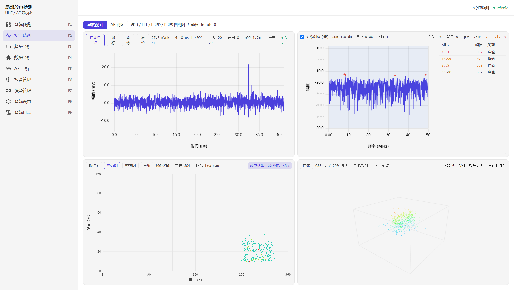
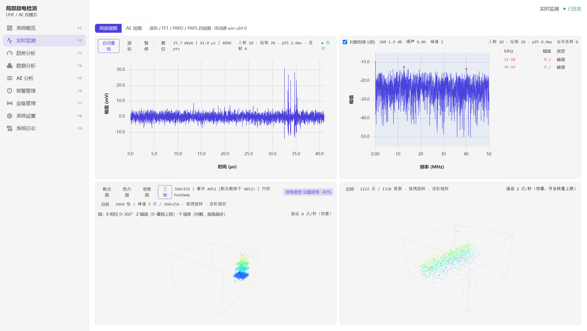
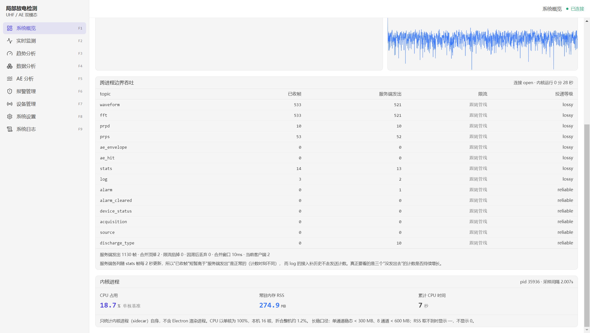
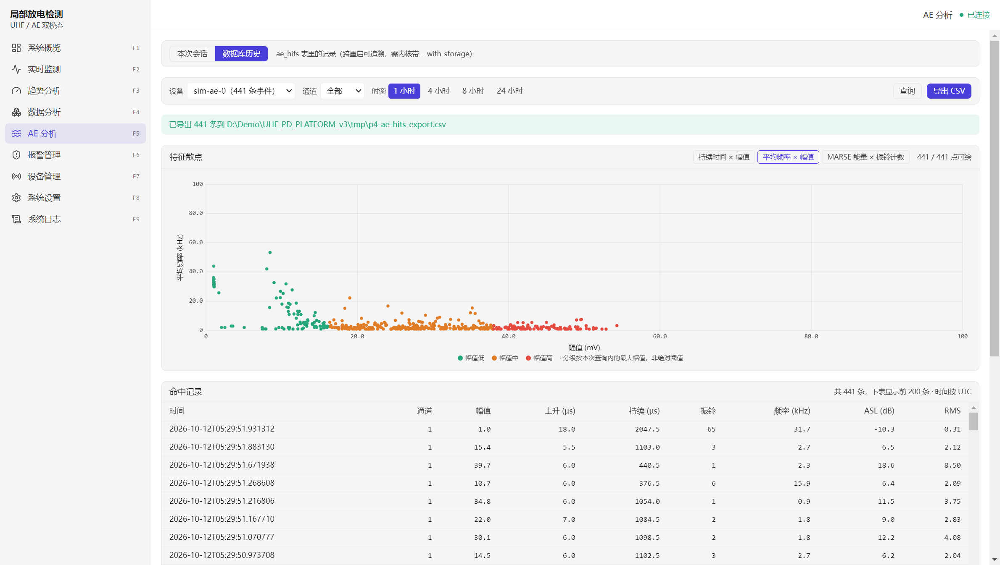
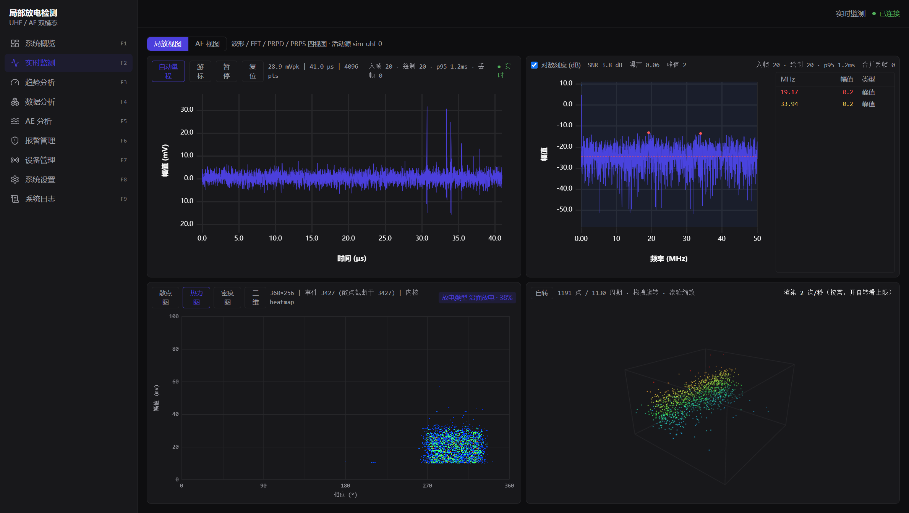
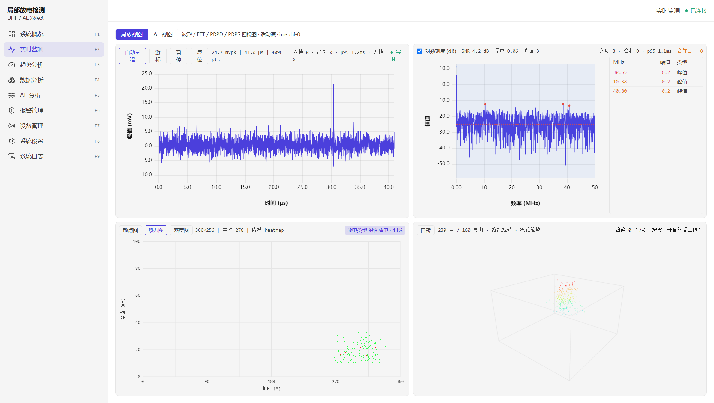

# 超高频超声波局部放电检测系统（UHF PD Platform v3）

[](https://www.python.org/downloads/)
[](https://www.electronjs.org/)
[](https://vuejs.org/)
[](https://www.typescriptlang.org/)
[](LICENSE)

工业级**局部放电在线监测**上位机。**UHF 超高频 + AE 超声波**双模态采集，实时波形/频谱/PRPD/PRPS
图谱、放电类型识别、报警、趋势分析与历史回溯。

> **版本 0.0.1** — 一次完成的架构重写：旧 PySide6 单体界面已下线，改为
> **Electron 前端 + Python 处理内核（sidecar）** 的双进程架构。



---

## 架构总览

前端与处理内核是**两个进程**，只通过本机 WebSocket 通信。内核不带界面，可独立运行、独立测试。

```
┌────────────────────────────┐        本机 WebSocket         ┌────────────────────────────┐
│  Electron 33 + Vue 3 + TS  │  ────────────────────────►   │  Python 处理内核（sidecar） │
│  desktop/                  │   /stream  有损实时数据       │  core/  + sidecar.py       │
│                            │   /ctrl    可靠事件 + RPC     │                            │
│  · 实时波形 / FFT          │  ◄────────────────────────    │  · FPGA / 仿真数据源        │
│  · PRPD / PRPS / PRPD-3D   │   msgpack 帧                  │  · 波形处理、峰值检测、FFT  │
│  · AE 包络 / 命中 / 定位   │                               │  · PRPD/PRPS 矩阵计算       │
│  · 趋势 / 报警 / 设备 / 设置│                               │  · 放电类型分类、报警判定   │
└────────────────────────────┘                               │  · SQLite 持久化            │
                                                             └────────────────────────────┘
```

| 目录 | 角色 | 技术栈 |
|---|---|---|
| `desktop/` | **现役前端**（唯一的界面） | Electron 33 · Vue 3 · TypeScript · Vite · Tailwind v4 · three.js · uPlot |
| `core/` | **处理内核**，保留为无头 sidecar | Python 3.10+ · numpy · scipy · PySide6（仅 signal/slot）· SQLAlchemy |
| `sidecar.py` | 内核入口 | 起 WebSocket 服务、装数据源、推流 |
| `_archive/` | 归档（旧 `ui/` PySide6 界面等），**不参与运行与测试** | — |

界面迁移的完整决策与实测数据见 [`docs/ELECTRON_REWRITE_PLAN.md`](docs/ELECTRON_REWRITE_PLAN.md)，
迁移覆盖度见 [`docs/migration_coverage.md`](docs/migration_coverage.md)。

---

## 核心特性

### 信号分析

| 模块 | 功能 |
|---|---|
| **实时波形** | 缩放 / 拖拽 / 游标测量 / 自动量程 / 触发标记 |
| **PRPD 图谱** | 散点图、热力图、密度图、**三维**（相位 × 幅值 × 对数强度）四种模式 |
| **PRPS 图谱** | 热力图与 3D 点云（相位 × 周期 × 幅值），512 × 360 周期脉冲序列 |
| **FFT 频谱** | 峰值检测（含谐波识别）、频段统计、噪声估计、SNR |
| **趋势分析** | 1h / 24h / 7d / 30d 多时间维度、多指标叠加 |
| **AE 声发射** | Hilbert 包络提取、hit 检测、参数提取、TDOA 声源定位（真 GDOP 精度热图） |



### 识别与报警

- **四种放电类型识别**：电晕 / 沿面 / 内部气隙 / 悬浮颗粒，基于 PRPD 统计特征的加权高斯核分类；
  实时标签直接显示在监测页 PRPD 面板徽标上。
- **三级报警体系**：严重 / 一般 / 提示；覆盖局放超限、设备离线、光模块异常、ADC 异常、
  同步异常、存储不足；带连续 N 次触发确认的防抖。
- 报警事件列表 + 统计 + 规则配置 + 确认流程，持久化到 SQLite。

### 数据与报告

- **跨重启持久化**：局放事件与 AE 命中分别落库（`pd_events` / `ae_hits`），支持按设备/通道/时窗回溯。
- **实验数据导入**：导入 CSV 后做放电类型识别与逐周期类型分布。
- **报告导出**：JSON / Excel / Word 三种格式（内核生成字节回传，主进程原生对话框落盘）。
- **运行时可观测**：内核 CPU / RSS / 累计 CPU 时间面板，数据源在线状态，推流吞吐与丢帧分类记账。

### 界面

- 亮色 / **暗色主题**（覆盖底层设计令牌，DOM / canvas / WebGL / uPlot 四类消费方全部跟随）。
- F1–F9 快捷键沿用旧版键位，现场操作肌肉记忆不变。









---

## 快速开始

### 只跑内核（不启界面）

用于观察协议与推流、做压测，不需要 Node。

```bash
pip install -e ".[dev]"

# 起一个 UHF 电晕仿真源，自动分配端口
python sidecar.py --sim-type uhf --pd-type corona --pulse-rate 60000

# 全部参数见 --help，不要凭记忆猜 flag
python sidecar.py --help
```

内核启动后会把端口与 token 打印到 stdout，前端据此连接。

### 起完整界面（开发模式）

Electron 主进程会**自动 spawn** Python sidecar，无需手动起内核。

```bash
cd desktop
npm ci
npm run dev          # Vite + Electron
```

### 测试

```bash
python -m pytest -q --no-cov                    # 内核全套（当前 557 passed）
cd desktop && npm run typecheck                 # vue-tsc + tsc(electron)
cd desktop && npm run build                     # 类型检查 + vite 打包 + 主进程编译
```

---

## 目录结构

```
UHF_PD_PLATFORM_v3/
├── desktop/                    # Electron + Vue 3 前端（现役界面）
│   ├── src/main/               # Electron 主进程：窗口、spawn 内核、原生对话框
│   ├── src/preload/            # contextBridge 暴露的窄桥
│   ├── src/renderer/           # Vue 应用
│   │   ├── views/              # 9 个页面（F1–F9）
│   │   ├── components/charts/  # 波形 / FFT / PRPD / PRPS / PRPD-3D / AE / GDOP
│   │   ├── lib/                # 协议客户端、主题、偏好、绘图工具
│   │   └── styles/             # 设计令牌（含暗色覆盖）
│   ├── sidecar.spec            # PyInstaller 冻结配置
│   └── electron-builder.json   # 装机包配置
├── core/                       # Python 处理内核
│   ├── communication/          # 数据源驱动（UDP / 串口 / 硬件）
│   ├── foundation/             # 数据总线、配置、数据源管理
│   ├── processing/             # 波形处理、峰值检测、FFT、PRPD/PRPS、趋势
│   ├── data/                   # 放电类型分类器、模型
│   ├── services/               # 报警、持久化、放电类型服务
│   ├── protocol/               # 帧定义、sidecar 服务端、RPC、推流
│   └── utils/                  # 仿真器、进程读数等
├── tools/                      # 验收与压测脚本（长稳、线性度、恢复、冻结冒烟）
├── tests/                      # 内核测试
├── docs/                       # 文档（见下方索引）
├── sidecar.py                  # 内核入口
└── _archive/                   # 归档：旧 PySide6 界面等（不参与构建/测试）
```

---

## 跨进程边界（协议）

内核与前端之间只有**一个契约**，两侧手工镜像，改一边必须改另一边：

- Python 侧：[`core/protocol/frames.py`](core/protocol/frames.py)
- 前端侧：[`desktop/src/shared/protocol.ts`](desktop/src/shared/protocol.ts)

**双通道**

- `/stream` —— 有损实时数据，最新帧胜出（`waveform` `fft` `prpd` `prps` `ae_envelope` `ae_hit` `stats` `log`）
- `/ctrl` —— 可靠事件 + RPC，**不允许限流**（`alarm` `alarm_cleared` `device_status` `acquisition` `source`）

URL 带 `?token=`，token 每次启动随机、由内核打印到 stdout。

**热图矩阵编码**：uint8 线性量化 + zlib（`meta.qmax` 反量化），渲染侧用原生
`DecompressionStream("deflate")` 解压。

---

## 打包（目标机不装 Python）

现场目标机没有 Python，内核以 **PyInstaller 冻结产物**交付，由 `extraResources` 铺进装机包。

```bash
cd desktop
npm run check:kernel      # 打包前检查内核依赖是否齐全
npm run build             # 构建前端
npm run build:kernel      # 重建冻结内核 -> ../dist/uhf-sidecar
npm run verify:kernel     # 冻结产物冒烟
npm run package:dir       # 出 win-unpacked 装机版
```

> **出包前必须重建冻结内核**：`dist/uhf-sidecar/` 是手工产物，不会跟着源码走，很容易把几天前的内核装进去。

---

## 文档索引

| 文档 | 内容 |
|---|---|
| [`AGENTS.md`](AGENTS.md) | **唯一的 agent 指令来源**：架构现状、硬约束、协议边界、四个语义陷阱 |
| [`docs/ELECTRON_REWRITE_PLAN.md`](docs/ELECTRON_REWRITE_PLAN.md) | 界面重写的完整决策与里程碑、实测数据 |
| [`docs/migration_coverage.md`](docs/migration_coverage.md) | 旧界面 → 新界面的功能覆盖度对照 |
| [`docs/DISCHARGE_TYPE_ANALYSIS.md`](docs/DISCHARGE_TYPE_ANALYSIS.md) | 四种放电类型的物理特征与判据规范 |
| [`docs/design/data-source-integration.md`](docs/design/data-source-integration.md) | 数据源集成设计 |
| [`docs/HANDOVER.md`](docs/HANDOVER.md) | 交接说明：现状、坑、下一步 |
| [`docs/AUDIT_AND_ROADMAP.md`](docs/AUDIT_AND_ROADMAP.md) | **项目体检报告**：功能完整性检查清单 + 业务流程检查 + 契约差集 + 缺口归类 + 下一步路线图 |

---

## 已知限制

这些是**口径未定**而非缺陷，动手前需先与现场/产品确认：

- **幅值单位**：全链路没有计数 → mV 的换算，`WaveformData.samples` 的 `(mV)` 只是未经实现的
  文档口径。模拟器输出 mV，真实数据是原始计数，两者相差约百倍。
- **PRPD 幅值轴只增不减**：纵轴是测量量程而非显示缩放，初值取大等于永久锁死。
- **三项功能卡在领域口径**：3D 定位视图（内核无 TDOA 通路）、等效放电量、最大重复率。
- 构建机与目标机差异、签名/镜像等打包约束见 `AGENTS.md` 的「硬约束」一节。

---

## License

[MIT](LICENSE)
